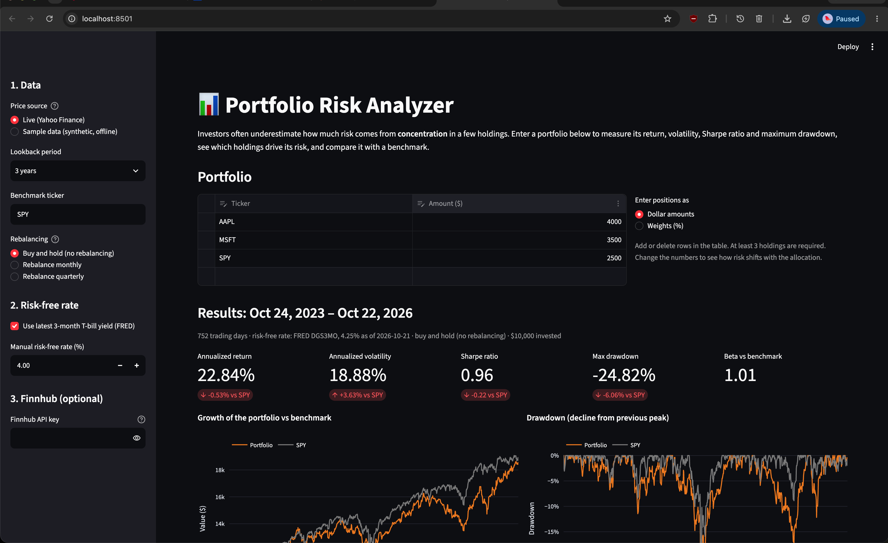
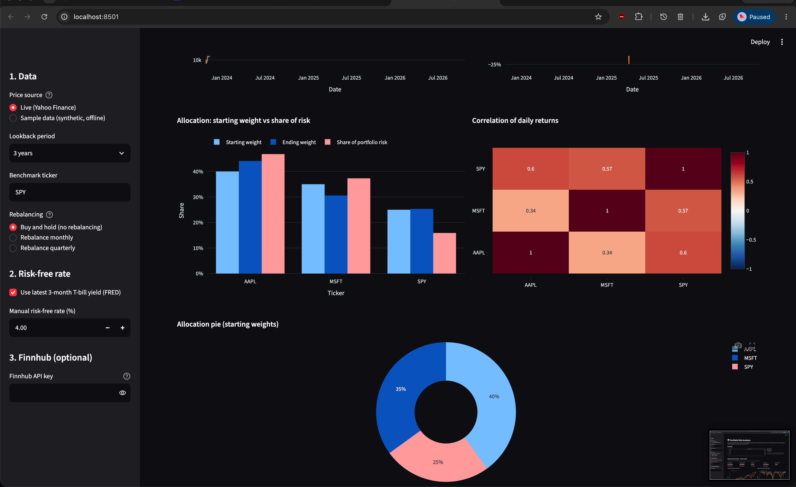

# Portfolio Risk Analyzer

An interactive Streamlit app that measures the performance and risk of a stock/ETF portfolio and compares it with a market benchmark.

**Financial problem:** investors often underestimate the risk that comes from individual securities and from concentrating money in a few holdings. This app shows how much each holding actually contributes to portfolio risk, how deep past losses were, and whether the portfolio was rewarded for the risk it took.

> Educational tool only. Not investment advice.

## Features

- Enter **3 or more** stocks/ETFs as **dollar amounts or % weights** (editable table; add/remove rows).
- Choose a lookback period (1, 3, 5 years or custom) and any **benchmark** ticker (default SPY).
- Choose **buy-and-hold** or **monthly/quarterly rebalancing** back to the target weights; the growth chart shows the rebalanced portfolio alongside buy-and-hold.
- Calculates **total and annualized return, annualized volatility, Sharpe ratio, maximum drawdown, beta**, and each holding's **contribution to portfolio risk**.
- Charts:
  1. Growth of the portfolio vs the benchmark
  2. Drawdown over time
  3. Starting weight vs ending weight vs share of risk, per holding
  4. Correlation heatmap of daily returns
  5. Allocation donut chart
- Plain-language interpretation of the results generated from the numbers.
- Optional **latest quotes from Finnhub** (price and daily change).
- Error handling: invalid/unknown tickers, fewer than 3 valid holdings, bad dates, short history, API outages (Yahoo, FRED, Finnhub), rejected API keys and rate limits all show a message instead of crashing.
- **Offline sample mode** using a bundled synthetic dataset, so the app can be demonstrated without internet.

## Screenshots

<!-- Replace with your own screenshots (live data) -->



## Installation and running

Requires Python 3.10+.

```bash
git clone https://github.com/<your-username>/portfolio-risk-analyzer.git
cd portfolio-risk-analyzer
python -m venv .venv
# Windows: .venv\Scripts\activate    macOS/Linux: source .venv/bin/activate
pip install -r requirements.txt
streamlit run app.py
```

The app opens at http://localhost:8501.

**Optional Finnhub key** (for latest quotes): create a free account at https://finnhub.io, then

```bash
cp .streamlit/secrets.toml.example .streamlit/secrets.toml   # then paste your key into it
```

Alternatively set the environment variable `FINNHUB_API_KEY`, or paste the key into the sidebar (kept for that session only). The app works fully without a key.

**Run the tests:**

```bash
python -m pytest
```

## Data sources

| Source | What it provides | Access |
|---|---|---|
| Yahoo Finance via [`yfinance`](https://github.com/ranaroussi/yfinance) | Daily adjusted closing prices (split- and dividend-adjusted) | Free, no key. Unofficial; for research/educational use |
| [FRED](https://fred.stlouisfed.org/series/DGS3MO) series DGS3MO | 3-month Treasury yield, used as the risk-free rate | Free public CSV download, no key |
| [Finnhub](https://finnhub.io/docs/api/quote) `/quote` | Latest price, change, previous close | Free tier, API key required (optional feature) |
| `data/sample_prices.csv` | **Synthetic** prices for offline demos (generated by `scripts/make_sample_data.py`, fixed seed) | Bundled. Not real market data |

Finnhub is used for quotes only because historical price candles are not part of its free tier, so historical prices come from Yahoo Finance (the assignment permits another free historical-price source).

## Financial concepts and calculations

All calculations are in `portfolio/metrics.py` and use 252 trading days per year.

| Measure | Formula | What it tells you |
|---|---|---|
| Portfolio value | Buy-and-hold: buy `amount / price` shares on day 1, never rebalance | How the money actually grew; weights drift with prices |
| Rebalanced value | At the close of the first trading day of each month/quarter, re-split the total value by the target weights (no trading costs) | Effect of keeping the allocation fixed instead of letting winners grow |
| Total return | V_end / V_start − 1 | Overall gain or loss |
| Annualized return (CAGR) | (V_end / V_start)^(252/N) − 1 | Growth rate per year, comparable across periods |
| Annualized volatility | std(daily returns) × √252 | Typical size of swings; the standard risk measure |
| Sharpe ratio | mean(daily excess return) / std(daily excess return) × √252 | Return earned per unit of risk, above the risk-free rate |
| Maximum drawdown | min(V_t / max(V_≤t) − 1) | Worst peak-to-trough loss an investor would have lived through |
| Beta | Cov(r_p, r_b) / Var(r_b) | Sensitivity to the benchmark |
| Risk contribution | w_i (Σw)_i / (w′Σw) | Share of portfolio variance from each holding; reveals concentration |
| Correlation | Pearson correlation of daily returns | Diversification: lower correlation, more benefit |

The unit tests in `tests/test_metrics.py` check these against small hand-calculated examples (e.g. a 120 → 90 fall is a −25% drawdown; a series that is exactly 2× the benchmark has beta 2).

## Project structure

```
app.py                      Streamlit user interface
portfolio/metrics.py        Return and risk calculations (pure functions)
portfolio/data.py           Yahoo Finance, FRED, Finnhub, sample data loading
scripts/make_sample_data.py Generates the synthetic offline dataset
data/sample_prices.csv      Synthetic dataset
tests/                      Unit tests and headless app tests
```

## How the AI coding agent was used

<!-- Fill in honestly: which agent (Claude Code / Codex / Antigravity), the prompts you gave,
     what you changed or rejected, bugs it helped find, and how you verified the numbers. Example points: -->
- Initial prompt describing the app, data sources, and required metrics; the agent proposed the module structure (data / metrics / UI).
- Iterations: …
- Bugs found and fixed: e.g. the Sharpe ratio of a flat series returned a huge number instead of "n/a" because floating-point noise made the standard deviation slightly above zero; fixed with a tolerance and a unit test.
- Verification: checked metrics against hand calculations and unit tests; spot-checked …

## Limitations

- All metrics are historical; past performance does not predict future results.
- One risk-free rate (the latest 3-month T-bill yield, or a manual value) is applied to the whole period instead of the rate in effect each day.
- Volatility and the Sharpe ratio assume roughly normal returns and understate tail risk.
- No taxes, fees or trading costs; dividends are treated as reinvested (adjusted prices).
- Buy-and-hold only; no periodic rebalancing option.
- Only dates on which every ticker has a price are used, so a recently listed security shortens the analysis window.
- Yahoo Finance data comes through an unofficial library and can be temporarily unavailable or incomplete.
- Risk contribution uses starting weights, not the drifted weights at the end of the period.
